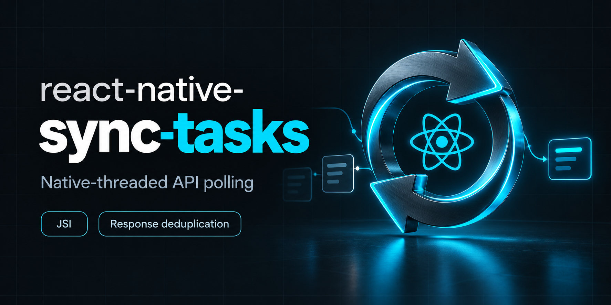

# react-native-sync-tasks

<p align="center">

</p>

Periodic HTTP polling for React Native that runs **on native threads**. Tasks are described in JavaScript; scheduling, requests and response deduplication happen in C++ and the platform HTTP stack, so the JS thread stays free.

> Polling runs while the app is active. It is not a background task manager.

## Features

- Native thread pool; the JS thread is never blocked
- Platform HTTP: `NSURLSession` on iOS, OkHttp on Android, TLS through the system trust store
- `onData` only when the body changes; conditional requests (ETag / Last-Modified) turn unchanged responses into `304`
- Timeout, exponential backoff, jitter, immediate first run, concurrency limit
- Any of `GET` `POST` `PUT` `PATCH` `DELETE`, request body, response headers
- `stop()` aborts the in-flight request; one task never runs concurrently with itself

## Requirements

- React Native **0.77+** with the New Architecture (tested on 0.87.1). The legacy architecture (RN 0.77–0.81) has a code path but is not tested yet
- iOS, Android `minSdkVersion` 24

## Installation

```bash
yarn add react-native-sync-tasks
cd ios && pod install
```

## Usage

```ts
import { createTask, SyncTasksManager } from 'react-native-sync-tasks';

const task = createTask<{ id: number; title: string }>({
  config: {
    url: 'https://jsonplaceholder.typicode.com/posts/1',
    interval: 2000,
  },
  onData: ({ body, status_code, headers }) => console.log(body.title),
  onError: ({ error, status_code }) => console.warn(status_code, error),
});

SyncTasksManager.addTask(task);
SyncTasksManager.startAll();

task.stop(); // pause one task
SyncTasksManager.removeTask(task); // stop and forget it
```

With more options:

```ts
createTask({
  config: {
    url: 'https://api.example.com/feed',
    method: 'POST',
    body: JSON.stringify({ since: 0 }),
    headers: { 'Content-Type': 'application/json' },
    timeout: 10000,
    immediate: true,
    jitter: 0.1,
    backoff: { multiplier: 2, maxInterval: 60000 },
  },
  onData: (data) => {},
});
```

## API

### `createTask<T>({ config, onData, onError? }): Task`

Invalid options throw immediately.

| `config` field | Default | Description |
|---|---|---|
| `url` | — | Endpoint to poll |
| `interval` | `1000` | Delay between polls, ms |
| `timeout` | `30000` | Limit for the whole request (connect, wait, read body), ms |
| `method` | `'GET'` | `GET` `POST` `PUT` `PATCH` `DELETE` |
| `body` | — | Request body string; not allowed with `GET` |
| `headers` | — | Request headers |
| `immediate` | `false` | First request right after the task is added, not after one `interval` |
| `jitter` | `0` | Random spread of each delay, fraction 0–1 (`0.1` = ±10%) |
| `backoff` | — | `{ multiplier = 2, maxInterval = max(interval, 60000) }` — after N failures in a row the delay is `interval × multiplierᴺ`, up to `maxInterval`; the next success resets it |
| `conditional` | `true` | `GET` only: send `If-None-Match` / `If-Modified-Since`; `304` means unchanged |

`onData` receives `{ body, status_code, headers }`, `onError` receives `{ error, status_code, headers }`. Header names are lowercased. Exported types: `Task`, `TaskConfig`, `TaskData`, `TaskError`, `CreateTaskParams`, `HttpMethod`.

### `Task`

| Method | Description |
|---|---|
| `start()` | Start or resume; the task must be added to the manager first |
| `stop()` | Stop; the in-flight request is aborted and its result dropped |
| `isRunning()` | Whether the task is running |

### `SyncTasksManager`

| Method | Description |
|---|---|
| `addTask(task)` / `addTasks(tasks)` | Add tasks; adding the same task twice has no effect |
| `removeTask(task)` | Stop, abort the request and forget the task; it can be added again |
| `startAll()` | Start every added task, including ones stopped individually |
| `stopAll()` | Stop every task and abort requests |
| `setMaxConcurrentRequests(n)` | Requests running at the same time, 1–64 (default 4) |

## Request behavior

| Response | Callback |
|---|---|
| 2xx/3xx, JSON | `onData` — skipped while the body equals the last delivered one (also after errors in between) |
| 2xx/3xx, empty (e.g. `204`) | `onData` with `body: null` |
| 2xx/3xx, not JSON | `onError` with the raw body — once while the body stays the same |
| `304` | none |
| 4xx/5xx | `onError` with the raw body — on every poll |
| Network, TLS, invalid URL, timeout | `onError` with `status_code: 0` and a platform message prefixed `Request error:` |

- The next poll is scheduled after the current request finishes, `interval` after it started.
- Redirects are followed and `gzip` is decoded. No HTTP cache, no cookies.
- Plain `http://` follows the platform policy: add an ATS exception on iOS and allow cleartext traffic ([Network Security Config](https://developer.android.com/privacy-and-security/security-config)) on Android.

## Upgrading from 0.1

- Requires React Native 0.77+.
- `http://` URLs are subject to ATS / Network Security Config.
- Error messages come from `NSURLSession` / OkHttp and differ per platform.
- Non-JSON success responses go to `onError` (they used to be dropped); empty bodies arrive as `body: null`.
- The URL is no longer the task id: two tasks may poll the same URL.

## Development

```bash
yarn test                      # JS unit tests
cd example && yarn harness:ios # on-device tests (also: harness:android)
```

The on-device suite ([react-native-harness](https://github.com/callstackincubator/react-native-harness), `example/harness`) runs against a local mock server and shows progress on screen. Physical-device runners are in `example/rn-harness.config.mjs`; the `external-tls` tests need internet access.

## License

MIT
